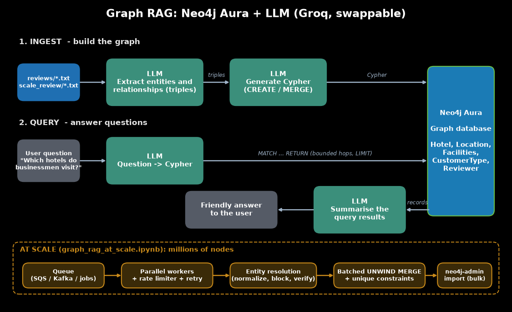

# Graph RAG with Neo4j Aura and an LLM

Build a knowledge graph from unstructured text with an LLM, store it in **Neo4j Aura**, and answer questions by turning them into graph queries. A second notebook explains and demonstrates how to scale the same design to **millions of nodes**.



## Contents

- [What this project does](#what-this-project-does)
- [Repository layout](#repository-layout)
- [Quick start](#quick-start)
- [Configuration](#configuration)
- [Notebook 1: hotel reviews Graph RAG](#notebook-1-hotel-reviews-graph-rag)
- [Notebook 2: Graph RAG at scale](#notebook-2-graph-rag-at-scale)
- [Data](#data)
- [Measured results](#measured-results)
- [Interview Q&A](#interview-qa)
- [Troubleshooting](#troubleshooting)
- [Security](#security)
- [Limitations and roadmap](#limitations-and-roadmap)

## What this project does

**Ingest (build the graph)**
1. Read hotel review text files.
2. An LLM extracts `(entity, relationship, entity)` triples against a fixed ontology.
3. An LLM turns the triples into Cypher `CREATE` statements.
4. The Cypher runs against Neo4j Aura.

**Query (answer questions)**
1. The user asks a question, for example *"Which hotels are visited by businessmen?"*
2. An LLM converts it to a Cypher query using the graph schema.
3. Neo4j returns the matching records.
4. An LLM turns the records into a friendly answer.

**Ontology**

| Node label | Meaning |
|---|---|
| `Hotel` | A hotel |
| `Location` | City or country |
| `Facilities` | Pool, wifi, gym, and so on |
| `CustomerType` | Businessmen, families, tourists, and so on |
| `Reviewer` | Person who wrote the review |

Relationships: `is_located_in`, `has_facilities`, `has_customers`, `has_reviewer` (all from `Hotel`).

**LLM provider is swappable.** The notebooks call one `chat()` helper. Set `LLM_PROVIDER` to use a local model (Ollama), Anthropic Claude, or any OpenAI-compatible API such as Groq. No OpenAI or Azure account is required.

## Repository layout

| Path | Purpose |
|---|---|
| `graph_rag_hotel_reviews.ipynb` | The working end-to-end example |
| `graph_rag_at_scale.ipynb` | Scaling guide with runnable offline demos |
| `graph_rag_architecture.png` | Architecture diagram (above) |
| `reviews/` | 5 real sample reviews used by notebook 1 |
| `scale_review/` | 2,000 generated reviews plus `truth.csv` (ground truth) used by notebook 2 |
| `make_scale_reviews.py` | Regenerates `scale_review/` at any size |
| `build_graph_rag_at_scale_notebook.py` | Generates `graph_rag_at_scale.ipynb` |
| `make_graph_rag_architecture.py` | Redraws the architecture image |
| `.env.example` | Template for your private `.env` |
| `.gitignore` | Keeps `.env` and caches out of git |

Naming convention: `snake_case` for every file and folder (`README.md` follows the GitHub standard name).

## Quick start

**Prerequisites:** Python 3.10+, a Neo4j Aura instance (free tier works), and one LLM option (a Groq/OpenAI-compatible key, an Anthropic key, or Ollama installed locally).

```powershell
git clone <your-repo-url>
cd <repo-folder>
python -m pip install requests python-dotenv neo4j networkx matplotlib notebook
Copy-Item .env.example .env
notepad .env
python -m notebook
```

Fill in `.env` (see [Configuration](#configuration)), open `graph_rag_hotel_reviews.ipynb`, **restart the kernel** so it re-reads `.env`, and choose **Run All**.

`graph_rag_at_scale.ipynb` needs no API key or database. Run it as is.

## Configuration

All settings come from `.env`.

| Variable | Required | Description |
|---|---|---|
| `NEO4J_URI` | notebook 1 | Full URI, for example `neo4j+s://<id>.databases.neo4j.io` |
| `NEO4J_USERNAME` | notebook 1 | Aura username (usually the instance id) |
| `NEO4J_PASSWORD` | notebook 1 | Aura password |
| `NEO4J_DATABASE` | notebook 1 | Aura database name (usually the instance id) |
| `LLM_PROVIDER` | no | `ollama` (default), `anthropic` or `openai` |
| `LLM_MODEL` | no | Model name for the chosen provider |
| `OPENAI_BASE_URL`, `OPENAI_API_KEY` | if `openai` | Any OpenAI-compatible endpoint, for example Groq: `https://api.groq.com/openai/v1` |
| `ANTHROPIC_API_KEY` | if `anthropic` | Claude API key |
| `OLLAMA_URL` | if `ollama` | Defaults to `http://localhost:11434` |

## Notebook 1: hotel reviews Graph RAG

`graph_rag_hotel_reviews.ipynb`, step by step:

1. **LLM client:** the `chat()` helper routes to the provider in `LLM_PROVIDER`. It retries on HTTP 429 and 5xx with backoff, and stops with a clear message when a daily quota is exhausted.
2. **Extract triples:** each review file in `reviews/` goes to the LLM with an ontology-constrained NER prompt.
3. **Generate Cypher:** the LLM turns the triples into `CREATE` statements. A `clean_cypher()` step strips markdown code fences.
4. **Write to Neo4j:** the Cypher runs against Aura using the official Python driver.
5. **Ask a question:** the question becomes Cypher via a schema-aware prompt, runs on Neo4j, and the records are summarised by the LLM.

Important behaviour:
- The write cell uses `CREATE`, so **re-running adds duplicate nodes**. Clear the graph first with `MATCH (n) DETACH DELETE n`, or move to `MERGE` (see notebook 2).
- LLM-written Cypher is not always consistent (for example `Facility` vs `Facilities`). Notebook 2 shows the safer pattern.

## Notebook 2: Graph RAG at scale

`graph_rag_at_scale.ipynb` answers the interview question *"How would you process millions of nodes, and how would you optimise it?"*. It runs offline.

| Section | Topic | Takeaway |
|---|---|---|
| 1 | Synthetic data | Entities appear under messy aliases, like real text |
| 2 | Parallel extraction | Worker pool plus a shared rate limiter plus retry and backoff |
| 3 | Idempotent checkpointing | A content hash per document means reruns repeat nothing |
| 4 | Entity resolution | Normalize, block, then fuzzy-match. Fuzzy-only matching merges different entities. |
| 5 | Batched writes | One `UNWIND ... MERGE` per few thousand rows beats a round trip per row |
| 6 | Optional Neo4j benchmark | Off by default. Touches only `:BenchEntity` nodes and cleans up. |
| 7 | Hub (supernode) handling | Degree caps shrink multi-hop expansion. Community summaries serve broad questions. |
| 8 | Query-time optimisation | Indexes, bounded traversal, ranking, caching, two-level retrieval |
| 9 | Capacity planning | Back-of-envelope time and cost (placeholder prices, replace with yours) |
| 10 | Run on `scale_review/` | Parallel extraction plus scoring against ground truth plus graph shape |

The Neo4j write pattern recommended there:

```cypher
CREATE CONSTRAINT entity_key IF NOT EXISTS FOR (e:Entity) REQUIRE e.key IS UNIQUE;

UNWIND $rows AS row
MERGE (a:Entity {key: row.sk}) ON CREATE SET a.name = row.s
MERGE (b:Entity {key: row.ok}) ON CREATE SET b.name = row.o
MERGE (a)-[:REL {type: row.r}]->(b)
```

Create the uniqueness constraint first (it doubles as the lookup index for `MERGE`). Send roughly 5,000 to 10,000 rows per query. For the very first load of tens of millions of rows, use `neo4j-admin database import`.

To turn on the Neo4j benchmark in section 6, set `RUN_NEO4J = True`.

## Data

**`reviews/`** holds 5 real reviews. Format: title line, `Hotel, City, Country` line, date, then the review body.

**`scale_review/`** holds generated reviews in the same shape, with:
- 150 hotels written as aliases such as `The Coral Tower Hotel`, `coral tower hotel`, `Coral Tower Hotel & Suites`
- 26 cities, with Dubai deliberately overrepresented (about 25 percent) as a hub node
- 18 facilities, 8 customer types and 400 reviewer names
- `truth.csv` with the correct triples (`file,hotel,relation,object`) so extraction quality can be measured

Regenerate at any size (deterministic, fixed seed):

```powershell
python make_scale_reviews.py 20000
```

## Measured results

Numbers from runs on the author's machine. They illustrate the effects, they are not benchmarks.

| Experiment | Result |
|---|---|
| Parallel (16 workers) vs sequential extraction, 100 simulated LLM calls | about 5x faster |
| Checkpointing | rerun processed 0 documents, new documents processed only the new ones |
| Entity normalization | 829 name variants became 314 entities |
| Per-row commit vs one batched transaction (SQLite analogy, 1,000 rows) | about 800x faster |
| Hub expansion at 2 hops (uncapped vs capped at 5 neighbours) | 260 nodes vs 24 |
| Extraction on `scale_review` (2,000 files, rule-based stand-in for the LLM) | 12,943 triples in 1.4 s, precision and recall 1.0 |
| Aura round trip from the author's machine | about 128 ms (network), server-side query work about 15 to 20 ms on a small graph |

Notes: the precision and recall of 1.0 are because a template-based extractor stands in for the LLM and matches the generated text exactly. A real LLM will score lower. That gap is the number to track. The latency figures are from a tiny graph, so they say little about millions of nodes.

## Interview Q&A

1. **How do you scale to millions of nodes?** Decouple stages with a queue. Use parallel extraction with a rate limiter. Write in batches with constraints. Bulk import the first load.
2. **How do you find the right nodes for a question?** Entity linking with a fulltext or vector index, then a bounded 1 to 3 hop expansion, ranking and trimming to the context window.
3. **Graph RAG vs vector RAG?** Graph wins on multi-hop questions, relationships and aggregations. Vector wins on fuzzy semantic lookup over text. Many systems combine both.
4. **Is Neo4j fast?** Traversals follow direct pointers, so cost does not grow with total data size. Time goes to the network, hub nodes, missing indexes and cold caches. Check with `PROFILE`.
5. **How do you handle hub nodes?** Cap degree per hop, filter relationship types, rank neighbours, precompute community summaries.
6. **How do you deal with duplicate entities?** Normalize, block, fuzzy or embedding match, verify ambiguous cases. Keep merges reversible.
7. **How do you make extraction reliable and cheap?** Constrain output to validated JSON, retry with backoff, use a cheap model or a batch API, checkpoint with content hashes.
8. **How do you keep the graph current?** Incremental `MERGE` keyed on document hashes, with source and timestamp on edges.
9. **How do you evaluate quality?** A labelled question set and ground-truth triples. Measure retrieval recall and answer accuracy on every prompt or model change.
10. **Security and cost risks?** Parameterized Cypher to prevent injection, treat ingested text as untrusted data (prompt injection), least-privilege database user, cost-per-document tracking, caching.

## Troubleshooting

| Symptom | Cause and fix |
|---|---|
| `429 Too Many Requests` | Free LLM tier rate limit. The helper retries automatically. If it reports quota exhausted, wait or switch `LLM_MODEL`. Make sure the kernel was restarted so the latest cell is loaded. |
| `ServiceUnavailable: Unable to retrieve routing information` | Aura instance is paused or still starting (check console.neo4j.io), or the TLS error below. |
| `SSLCertVerificationError: self signed certificate in certificate chain` | A corporate proxy re-signs TLS. Dev-only workaround: use `neo4j+ssc://` in `NEO4J_URI`. Proper fix: install the company root certificate. |
| `ModuleNotFoundError` after `pip install` | `pip` and `python` point at different Pythons. Use `python -m pip install ...`. |
| Duplicate nodes after re-running notebook 1 | The write cell uses `CREATE`. Clear the graph first or use `MERGE`. |
| Model not found on Groq | Model names vary per key. List them: `GET {OPENAI_BASE_URL}/models`. |

## Security

- **Never commit `.env`.** It is in `.gitignore`. Commit only `.env.example`.
- If a key or password was ever pasted into a chat, ticket or commit, treat it as exposed and rotate it.
- `neo4j+ssc://` disables certificate verification. Use it for throwaway dev instances only.
- Notebook output cells can contain local paths, error text and query results. Clear outputs before publishing if that matters (`Edit` then `Clear All Outputs`, or `jupyter nbconvert --clear-output --inplace <file>`).
- LLM-generated Cypher is executed as written. Use a database user with only the permissions the notebook needs.

## Limitations and roadmap

- Notebook 1 trusts LLM-generated Cypher. Move to validated triples plus a parameterized `MERGE` loader.
- Entity resolution is normalization only. Add embedding-based candidate matching with verification.
- Entity linking in the query path currently relies on the LLM writing a correct Cypher match. Add a fulltext or vector index for linking.
- Possible storage alternatives behind the same three operations (upsert triples, find entities, expand neighbourhood): Neo4j (current), Databricks Delta tables, PostgreSQL with Apache AGE, Amazon Neptune, Azure Cosmos DB Gremlin.
- Add an evaluation set of questions with expected answers.

## License

Add a license of your choice before publishing (for example MIT) as a `LICENSE` file.
